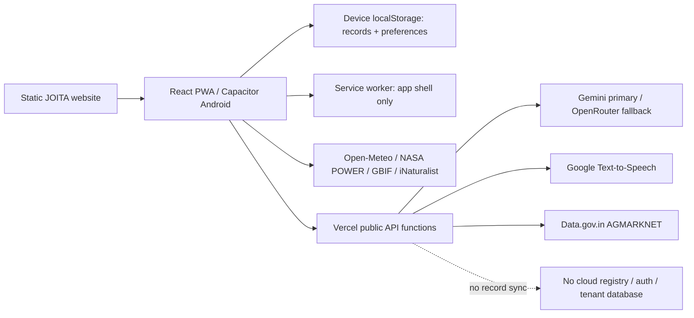
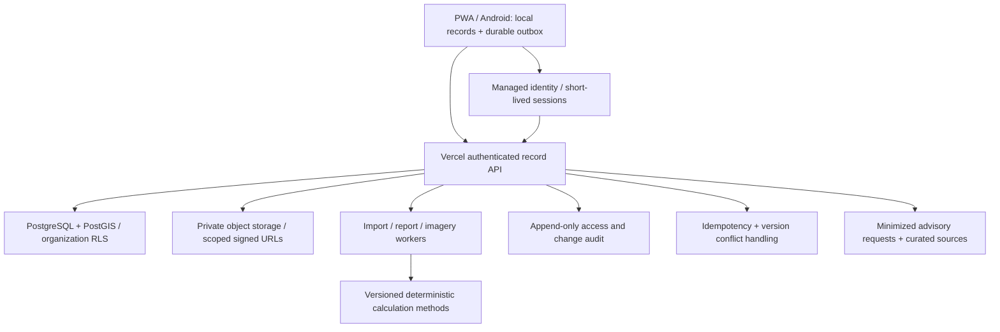

# JOITAFA / ClimateOS baseline

Recorded 2026-10-14, before Release 1 application changes. Scope: the actual
`prakau/joitabioseedai.github.io` checkout, main at `5dd1c74`.

## Executive audit

Keep the existing React application, Vercel deployment, `/farmassist/` URL,
Android package ID and device record keys. This is a useful farmer-tool suite,
not yet an authenticated, multi-tenant climate evidence platform.

- Frontend: React 18, TypeScript, Vite 6, React Query, HashRouter, Tailwind,
  Lucide, Three.js. Source `farmassist-src/`; web build `farmassist/`.
- Backend: four public Vercel functions: health, advisory, speech and market.
  No record database, identity provider, tenant permissions, record-sync
  endpoint, object store or background import worker was found in this repo.
- Website: static HTML/CSS/JS. `vercel.json` installs API and app dependencies,
  builds the app and serves the repository. CNAME must remain unchanged.
- Android: Capacitor 8 reuses the app. Current downloadable test APK is older
  than the latest web features; a web deployment does not update installed APKs.
- PWA: app-scoped service worker `joita-farmassist-v5`; cached shell/assets and
  local records work offline. APIs are excluded from shell cache. Offline is
  not cross-device synchronization.
- Live GET `https://www.joitabioseedai.com/api/health` returned HTTP 200,
  `ok: true`, all four key-presence flags true, environment production,
  timestamp `2026-10-14T04:02:02.218Z`. This verifies configuration and the
  endpoint, not successful external provider calls, persistence or auth.

Prior unfinished homepage improvements are present in the working tree:
task finder, product search/comparison, and a one-submit website-to-app question
handoff. Preserve and regression-test them; do not call them deployed yet.

## Existing architecture

## Implementation evidence and limitations

| Area | Implemented behavior in code | Not established / missing |
| --- | --- | --- |
| Ask / Diagnose | Server-side providers, timeouts, safety checks, Hindi/Roman-Hindi routing, source/fallback labels, real image transport, saved answers | No curated versioned document RAG or agronomist-reviewed evaluation set; provider availability is variable |
| Diary | Local dated observations, counts, reports, follow-up tasks | Plot is free text, no farmer/season foreign keys, consent, evidence review or immutable edit history |
| Sale / ledger / calculators | Pure arithmetic with units, local offers/transactions, exports | No verified sales, payments, financial advice or measured climate savings |
| Calendar | Dated tasks, crop guides, editing, completion, ICS export | BUG: due date is not checked against sowing; future planting can have an overdue scouting task |
| Plot | Interactive Three.js layout, validated dimensions, local saves | Not a surveyed geographic polygon or land-title/area verification |
| Soil | User-entered lab values, units, screening references | Not a lab integration or automatic fertilizer prescription |
| Weather / market | Dated live feeds and same-location/filter caches | No guarantee of publication freshness; NASA climatology is not current weather |
| Sound | Local signal/activity measurements | Not validated EHI, species identification or ecosystem health |
| Community | Local notes and explicit share/email | Not a shared online community |
| Settings | Profile, export, cache/provider diagnostics | No restore, identity, cloud sync or safe multi-tenant registration |
| ClimateOS / Passport | No production implementation found | All registry, institutional access, MRV and passport workflows require foundations first |

Screens alone are not evidence of a working integration. Existing unit/API,
Playwright and offline test suites are present; re-run and record results in
the release report. Browser provider fixtures do not prove live AI correctness.

## Data and disclosure map

- `joita-fa-questions`: saved question/context/answer, localStorage. Uploaded
  photos are sent for live inference, not retained in saved history.
- `joita-fa-diary-v1`: crop/plot text, observations and sampled plant counts.
- `joita-fa-plans-v3`, `joita-fa-layouts`, `joita-fa-soils-v3`,
  `joita-fa-sound-v3`, `joita-fa-posts`, `joita-fa-ledger-v1`,
  `joita-fa-sale-comparisons-v1`: local records. Old soil/EHI keys remain
  exportable for continuity, not newly validated measurements.
- Profile, advisory preferences and selected weather location are device-local.
  API caches include location/filter and retrieval/source times.
- Audio is processed locally; read-aloud sends the completed answer to Google
  only after the user's action. Crop image bytes/questions/context go to live
  providers when requested. Do not upload personal documents.
- No automatic upload of farm records was found. Exported JSON and local browser
  storage are not application-encrypted; anyone with device/profile/file access
  may read them. Clearing site data or uninstalling can remove records.

## Privacy and security risks

1. **Release blocker for institutions:** no authenticated identities, consent
   records, organization scope, RLS or tenant isolation. Do not accept the
   reported 50,000 outreach contacts into the app as consenting users.
2. **Data-loss risk:** localStorage quotas and browser eviction; no restore.
   Preserve existing keys, add validated merge restore and recovery checkpoints
   before any larger persistence migration. Checkpoints on the same device are
   not disaster recovery; downloaded backups remain necessary.
3. **Public API abuse:** chat/speech use process-local rate-limit Maps, not a
   global quota. Add shared limiting before institutional scale. Provider quotas
   and billing alerts are operator tasks, not proven by this checkout.
4. **Model disclosure:** free text may contain personal information despite UI
   warnings. Review retention/provider contracts and data minimization; never
   send entire farmer profiles, contact lists or evidence documents by default.
5. **Audit limits:** current operational logs are not immutable evidence trails.
   User-supplied crop/location fields are not guaranteed anonymous. Production
   logs and external security settings were not available for a full audit.
6. **Public origin:** public advisory endpoints are not authorization for farmer
   records. CORS is not authentication. Future APIs must authorize each object.
7. **Secrets:** no tracked `.env` or Vercel local config found. Keys pasted in
   historical chats should be rotated by the operator; never copy them into
   this repository, frontend, backups or tests.
8. **Scientific claims:** self-report is not independent verification; estimates
   are not measurements or issued carbon credits. Unapproved products must not
   become commercial AI prescriptions. No regulator or methodology endorsement
   is inferred from website material.

## Technical debt

- Unused root CRA package/scripts conflict with the actual Vite build; use the
  documented `farmassist-src` commands, not root `npm run build`.
- React 18 uses React 19 type packages; align in a separate compatibility change.
- Large eager Three.js bundle affects mobile loading. Profile/lazy-load with
  offline chunk coverage before splitting; do not break cold offline use.
- README has stale language/API-key/timeout descriptions; correct against code.
- Optional Pl@ntNet adapter is not an active diagnosis service. Do not expose
  browser key input or call it integrated.
- Storage readers validate only shallow shapes. Imported backups must be
  allowlisted and validated, never accepted as arbitrary localStorage writes.
- Some tools still have English-only forms. New release controls need Hindi
  equivalents; complete translation remains backlog, not a blanket claim.

## Proposed target architecture (not deployed)

Preferred proposal: managed PostgreSQL/PostGIS, identity and private object
storage (Supabase is one option). No provider chosen/provisioned by this release.
Keep Vercel and stable public routes. Deploy additive APIs; never expose a
database service-role credential to clients. New account features may be gated,
but current public advisory/offline tools remain available.

## Proposed relational schema

All tenant-owned tables: UUID primary key, `organization_id`, created/updated
timestamps, actor ID, integer revision and appropriate deletion/retention state.
Use compound foreign keys including organization ID to prevent cross-tenant
references. Server derives authorized organizations from memberships, not a
client-submitted role. SQL RLS and API authorization must both be tested.

| Entities | Core fields / constraints |
| --- | --- |
| Organization, User, Membership | Distinct JOITA and Radhaa organization IDs; identity subject unique; membership unique(org,user), role and status |
| Farmer, Consent | Farmer internal ID, language, village/district/state, optional restricted contact; consent version/purpose/granted/withdrawn times, actor and evidence; no contact-based auto-enrollment |
| Farm, Plot, CropSeason | farmer/farm parent FKs; optional polygon SRID 4326, validated geometry and area method/units; sowing/harvest constraints and season identity |
| Programme, Enrollment, Assignment | org-scoped programmes, membership/consent-purpose checks, enrollment status, agent assignments; explicit cross-programme allocation to prevent double counting |
| Observation, Activity, Intervention | plot/season, event time/type, value+unit, evidence class, recorder, revision/history, review and synchronization status |
| EvidenceAsset | private storage path, checksum, MIME/size, capture/upload dates, owner, retention, permission scope; no unrestricted public PII URLs |
| SourceDocument | publisher, citation, version, scope, license, review/expiry and retrieval metadata |
| CalculationMethod, CalculationRun | immutable version/formula, inputs with provenance, baseline/period, units, assumptions, limitations, timestamp, reviewer; never LLM-as-calculator |
| VerificationReview, Report | scoped reviewer, decision/history; report snapshot, method/source versions, facts vs estimates, authorization and expiry |
| SyncEvent, AuditEvent | idempotency key unique(org,device,event), expected revision, conflict response; server timestamp, actor/action/object, minimal audit payload |

Indexes: tenant + district/search keys, farmer/plot/season parents, programme
status, review queues, event dates and PostGIS spatial index. Cursor pagination
and background validation/import batches are mandatory at 50,000 records.
Duplicate contact matches generate review candidates, not automatic merges.

## Migration risks and strategy

1. Export current device data and add restore tests first. No silent re-keying.
2. Provision a separate development backend with synthetic data; approve data
   processing, retention, lawful purposes and JOITA/Radhaa sharing agreements.
3. Add identity, database migrations/RLS, private storage and contract tests.
   Demonstrate organization A cannot read/write/export organization B records.
4. Add stable-ID local registry and consent, retaining original source IDs.
   Upload only user-selected records after authenticated purpose-specific consent.
5. Add an IndexedDB outbox with retries, idempotency, expected revisions and
   explicit conflict resolution. A reconnect must not imply successful sync.
6. Dual-read existing local records; use explicit migration checkpoints and
   rollback exports. Never delete the old store until counts/checksums agree.
7. Controlled small institutional pilot before bulk imports or public rollout.

## Prioritized backlog and release gates

| Priority | Deliverable | Dependency / acceptance gate |
| --- | --- | --- |
| P0 / R1 | Calendar date relation, explicit pre-plant reason, legacy repair state | Unit and UI cases incl. invalid dates, future planting, legitimate pre-plant work |
| P0 / R1 | Validated versioned backup, merge restore, local recovery checkpoint, truthful storage status | Conflict/idempotence/failure/refresh tests; preserve original records |
| P0 / R1 | Secure auth + tenant storage + shared API rate limits | Provisioned provider, role policy and approved migration; no fake login or sync |
| P0 / R1 | Regression and offline tests; documented deployment | Existing routes/CNAME preserved; test results and limits reported |
| P1 / R2 | Registry, consent/withdrawal, plots/seasons, extend Crop Diary | R1 auth + RLS + durable sync; duplicate and consent tests |
| P1 / R3 | WaterSmart + authorized Passport PDF/CSV | Registry/evidence, validated methods, reviewed references and report authorization |
| P1 / R4 | ClimateOS operations, programmes, agent/reviewer queues | Tenant isolation, programme allocation, grievance/retention policies |
| P2 / R5 | Curated RAG, model evaluation, MRV methods, satellite | Licensed/versioned sources, agronomist review, scientific validation, imagery budget |

## First implementation increment

Implement the unblocked R1 stability work now: calendar correctness, validated
backup/restore, transactional device recovery checkpoints and accurate local/cloud
status, tests and documentation. Finish regression of the existing pending
homepage enhancements. Do not build disconnected registry/Passport/enterprise
screens or represent secure auth/cloud sync as complete. Provisioning and
tenant-security work remain explicit R1 release blockers.

### User decision after baseline

The user selected **their existing managed PostgreSQL and identity provider**.
Do not create a new Supabase service or replace the existing identity system.
Provider names and integration documentation are still needed; request names
and documentation paths only, not credentials in chat. No migration has run.
